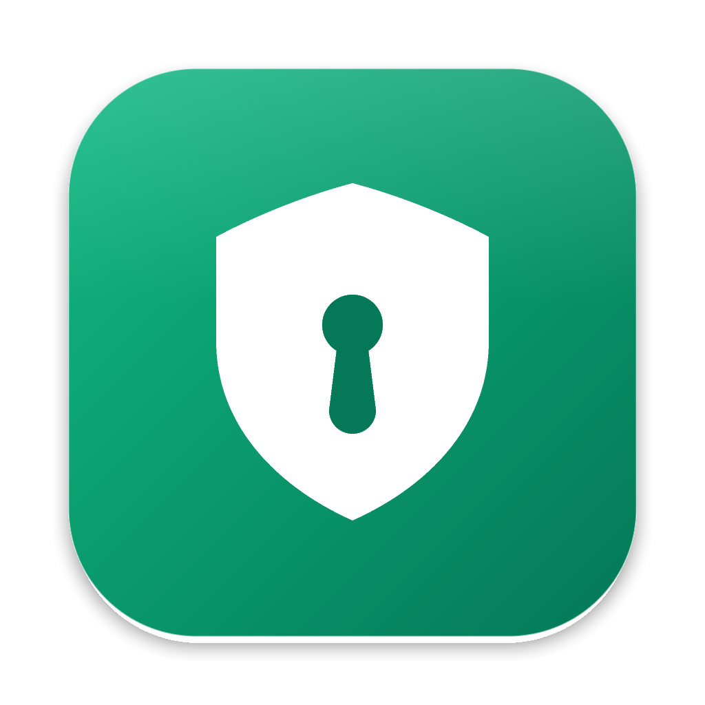
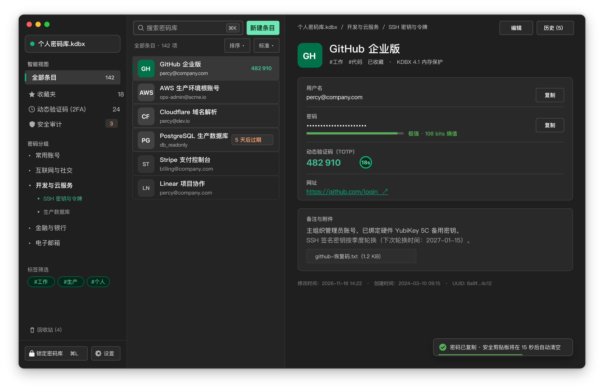
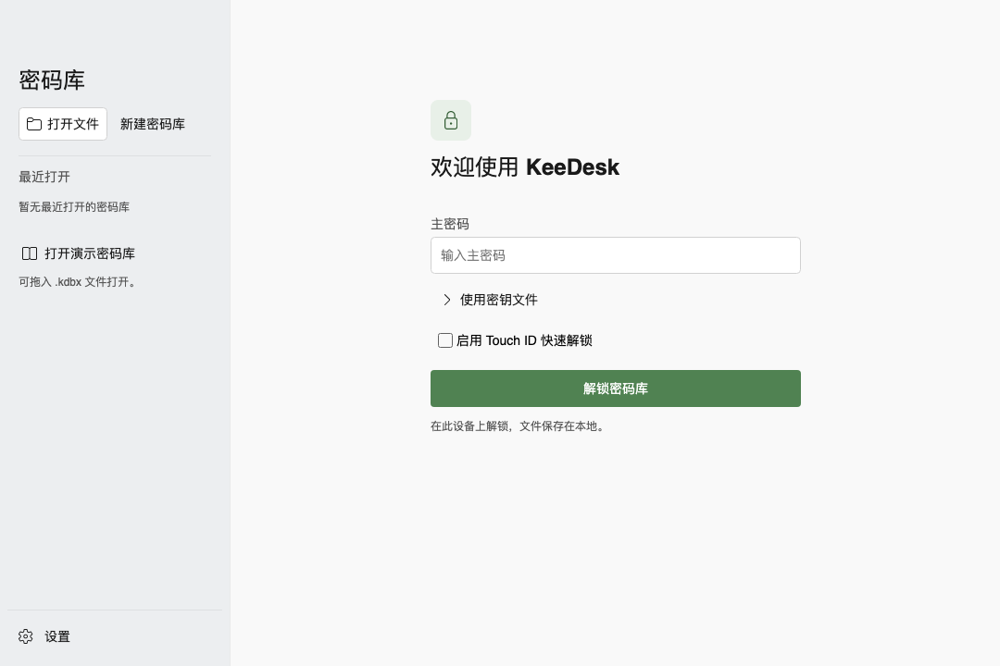

<div align="center">



# KeeDesk

**适用于 macOS、Windows 和 Linux 的本地 KeePass 密码管理器**

管理多个密码库，生成密码，并在登录时使用自动输入和动态验证码。

<p>
  <a href="https://github.com/pengpercy/KeeDesk/releases/latest"></a>
  
  
  <a href="https://github.com/pengpercy/KeeDesk/actions"></a>
</p>

<p>
  <a href="https://github.com/pengpercy/KeeDesk/releases/latest">下载安装</a> ·
  <a href="#界面预览">界面预览</a> ·
  <a href="#核心特性">核心特性</a> ·
  <a href="#保护你的密码库">密码库保护</a> ·
  <a href="#快捷操作">快捷键</a>
</p>

</div>

---

Windows 上首次升级到 KeeDesk 时，请关闭旧版，从下载页下载并解压新版压缩包，再启动 `KeeDesk.exe`。KeeDesk 会读取原有设置和最近打开的密码库列表。

## 产品简介

KeeDesk 将密码库以加密文件保存在本地。已有的 KeePass 密码库可以直接打开，支持 KDBX 3.1、4.0 和 4.1。你可以同时打开个人和工作密码库，也可以从其他密码管理器导入条目。

日常登录时，可以从密码库复制用户名、密码和动态验证码，也可以用自动输入填写登录表单。安全审计帮助找出弱密码、重复密码和即将到期的条目。欢迎页提供示例密码库，可以先体验这些功能。

---

## 界面预览

工作台、条目编辑和安全审计界面使用应用内置的示例密码库。

### macOS 三栏主工作台（深色 / 浅色模式）

| 深色模式（Dark） | 浅色模式（Light） |
| :---: | :---: |
|  |  |

### 欢迎解锁页与 Windows 11 工作台

| 欢迎与密码库解锁 | Windows 11 工作台布局 |
| :---: | :---: |
|  |  |

### 条目编辑与安全审计

| 条目编辑 | 安全审计 |
| :---: | :---: |
|  |  |

---

## 核心特性

### 管理密码库

- 同时打开多个密码库，切换时保留各自的浏览位置和选中条目。
- 使用主密码、密钥文件或 Windows 用户账户解锁支持的密码库。macOS 支持 Touch ID 快速解锁。
- 合并不同设备上的密码库副本，也可以把密码库文件放在常用的同步文件夹中使用。
- 支持 KeePass XML 导入和导出、从 Chrome、Edge、Bitwarden 和 1Password 的 CSV 文件导入，以及导出可打印的应急表。

### 查找条目与登录

- 按分组、标签、收藏和到期时间浏览，或用高级查找指定要搜索的字段。
- 使用密码生成器创建随机密码或密码短语，并在条目内查看动态验证码和剩余时间。
- 使用自动输入将登录信息填入目标窗口。macOS 和 Windows 支持按全局快捷键查找匹配条目。
- 在条目中保存附件和备注，引用其他条目的字段，或批量移动、收藏和删除条目。

### 自定义外观

- 在浅色、深色和跟随系统之间切换，可选择默认的橄榄绿、其他预设颜色或自定义颜色。
- 可选紧凑、标准和宽松三档布局，支持简体中文与 English。

---

## 保护你的密码库

- **本地加密**。密码、备注和附件随密码库一起加密保存。可以在密码库设置中更换主密码和密钥文件。
- **自动锁定**。可设置闲置自动锁定时间。也可以一键锁定所有已打开的密码库。
- **剪贴板保护**。复制密码或验证码后，应用会在设定时间到达时清除尚未替换的剪贴板内容。在支持的平台上，应用会标记敏感内容以排除剪贴板历史记录。
- **安全审计**。集中查看弱密码、重复密码以及已过期或即将到期的条目。

---

## 快捷操作

| 快捷键（macOS / Windows & Linux） | 功能 |
| :--- | :--- |
| `⌘K` / `Ctrl+K` | 聚焦全局快速搜索框 |
| `⌘F` / `Ctrl+F` | 打开高级查找弹窗（支持正则） |
| `⌘N` 或 `⌘I` / `Ctrl+N` 或 `Ctrl+I` | 新建密码条目 |
| `⌘D` / `Ctrl+D` | 克隆当前选中条目 |
| `⌘B` / `Ctrl+B` | 复制用户名（支持字段引用解析） |
| `⇧⌘C` / `Ctrl+Shift+C` | 复制密码（自动清空） |
| `⇧⌘T` / `Ctrl+Shift+T` | 复制动态验证码（TOTP） |
| `⌘U` / `Ctrl+U` | 在默认浏览器打开网址 |
| `⌃⌥A` / `Ctrl+Alt+A` | 全局自动输入（macOS 和 Windows，按当前窗口标题匹配） |
| `⌘S` / `Ctrl+S` | 保存当前密码库 |
| `⌘L` / `Ctrl+L` | 立即锁定全部密码库 |

---

## 开发与测试

本地运行和测试需要安装项目使用的 [SDK](https://dotnet.microsoft.com/download/dotnet/10.0)。各平台的打包入口见 [发布工作流](.github/workflows/release.yml)。

```bash
dotnet test KeeDesk.sln
dotnet run --project src/KeeDesk/KeeDesk.csproj
```
