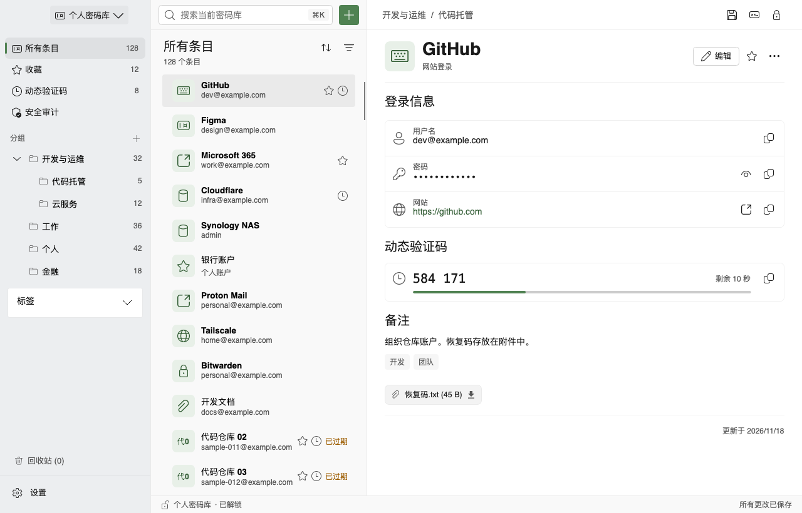
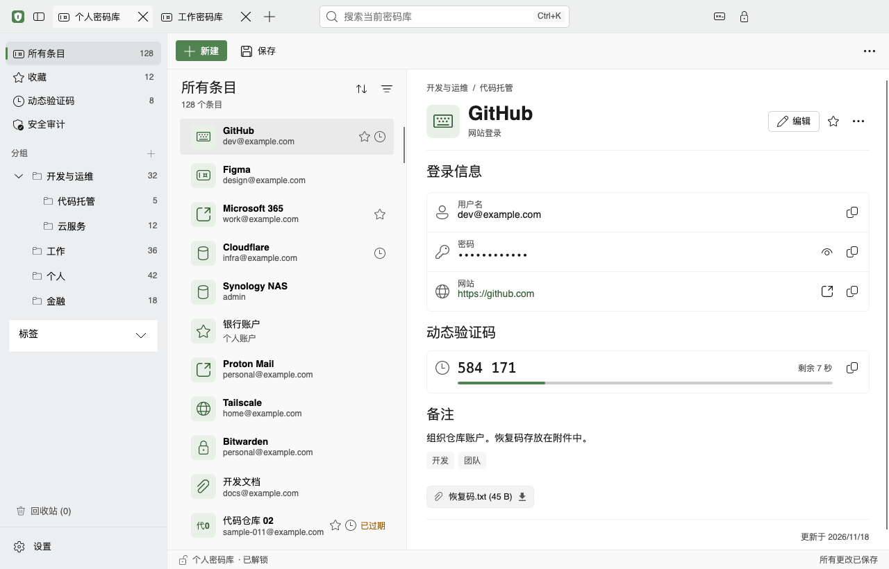
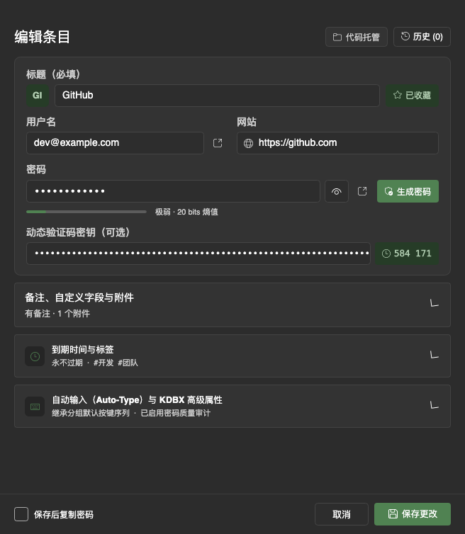
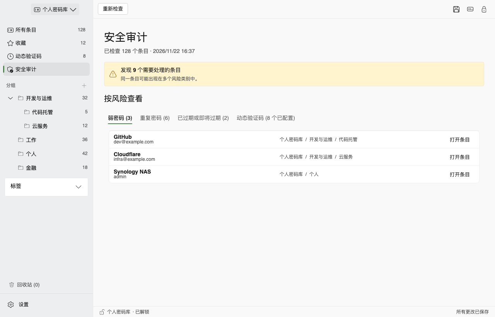

<div align="center">


# KeePassModern

**现代化、跨平台、原生高性能的 KeePass 密码管理器**

基于 **Avalonia 12 + .NET 10 + NativeAOT** 与 **Microsoft Fluent 2 Design System** 匠心打造  
完全兼容 **KDBX 3.1 / 4.0 / 4.1** 标准 · 原生支持 **macOS / Windows / Linux**（x64 & arm64）

<p>
  <a href="https://github.com/pengpercy/KeePassModern/releases/latest"></a>
  <a href="https://dotnet.microsoft.com/"></a>
  <a href="https://avaloniaui.net/"></a>
  
  
  <a href="https://github.com/pengpercy/KeePassModern/actions"></a>
</p>

<p>
  <a href="#界面预览">界面预览</a> ·
  <a href="#核心特性">核心特性</a> ·
  <a href="#安全与加密架构">安全架构</a> ·
  <a href="#快捷操作">快捷键</a> ·
  <a href="#构建与打包">构建与打包</a>
</p>

</div>

---

## 产品简介

**KeePassModern** 是对经典开源密码管理器 KeePass 2.x 的现代化跨平台重写。它在严格保持与原版 `.kdbx` 密码库 100% 互通（包括 KDBX 3.1 / 4.0 / 条件 4.1 格式、XML v2.0 `.keyx` 密钥文件、Windows DPAPI 用户账户密钥及 UUID 双向无损合并）的同时，彻底革新了视觉体验、交互效率与运行性能：

- **极致轻快**：纯托管零反射核心 + `.NET 10 NativeAOT` 编译为单文件原生机器码，冷启动瞬开，安装包仅 ~28–39 MB。
- **原生美学**：严格遵循 **Microsoft Fluent 2** 与各平台原生桌面规范（macOS 全高三栏 + 交通灯对称居中 + 原生顶部菜单栏 + `zh-Hans.lproj`；Windows 11 48px Mica Alt 一体化标题栏）。
- **隐私至上**：100% 离线本地加密，进程内敏感内存 XOR 混淆与 `ZeroMemory` 清零，剪贴板防历史留痕（macOS `ConcealedType` / Windows `ExcludeFromHistory`），合盖休眠与锁屏自动锁定。

---

## 界面预览

以下为 Fluent 2 V3 界面渲染预览，使用应用内置的示例密码库。

### macOS 三栏主工作台（深色 / 浅色模式）

| 深色模式（Dark） | 浅色模式（Light） |
| :---: | :---: |
|  |  |

### 欢迎解锁页 & Windows 11 桌面端

| 欢迎与密码库解锁 | Windows 11 工作台布局 |
| :---: | :---: |
|  |  |

### 单页卡片式条目编辑器 & 安全审计仪表盘

| 零选项卡条目编辑器（支持自动抓取官网 Favicon） | 实时安全审计仪表盘 |
| :---: | :---: |
|  |  |

---

## 核心特性

### 1. 完整 KDBX 核心与多库管理
- **全版本兼容**：原生读写 KDBX 3.1 / 4.0 / 4.1，按 KeePass 2.x 规范条件升级。
- **多密码库标签页**：支持同时打开多个 `.kdbx` 密码库自由切换，各自保留视图与选中状态，支持一键锁定全部库。
- **数据库合并同步**：基于 UUID、最后修改时间与 `DeletedObjects` 的双向无损合并，完美配合 iCloud / OneDrive / Syncthing 云盘同步。
- **复合主密钥**：支持主密码、密钥文件（XML v1.0 / 带哈希校验 XML v2.0 `.keyx` / 32B Raw / 64Hex / 任意文件）、**Windows 用户账户密钥（DPAPI，100% 互通原版 `%APPDATA%\KeePass\ProtectedUserKey.bin`）**，以及一键生成 `.keyx`。
- **在线密码库设置与维护**：在线修改主密码/换绑密钥文件、调整加密算法与 KDF 参数；内置维护工具一键清理过期历史快照、重复条目、空分组、已删除对象元数据与未使用图标。

### 2. 高效密码管理与自动化
- **内置 2FA（TOTP）**：实时计算动态验证码与倒计时，兼容 `otpauth://` 与 `TimeOtp-*`。
- **跨平台自动输入（Auto-Type）**：支持条目右键/按钮一键输入与 **OS 级全局热键（macOS `Control+Option+A` / Windows `Ctrl+Alt+A`）**，自动探测前台窗口标题匹配条目，完整解析 `{USERNAME}`、`{PASSWORD}`、`{TOTP}`、`{REF:...}`、`{TAB}`、`{ENTER}`、`{DELAY}` 与分组继承序列；macOS 无辅助功能权限时自动触发系统授权引导并打开设置面板。
- **官网 Favicon 自动抓取**：根据条目网址或邮箱域名自动拉取高清网站图标（支持直接输入图片 URL 或上传本地 PNG），按 SHA-256 去重存入 KDBX `CustomIcons`。
- **可视化字段引用向导**：告别手写语法，弹窗可视化插入 `{REF:P@I:...}` 跨条目引用。
- **高级查找与快速筛选**：支持正则表达式、区分大小写、按字段范围检索；内置「已过期 / 7 天内到期 / 30 天内到期 / 最近修改 / 大体积条目」快捷视图。
- **批量操作与拖拽**：支持 `Cmd/Ctrl` 多选条目批量移动/收藏/删除，支持拖拽条目到左侧分组树移动，支持直接拖入 `.kdbx` / `.keyx` 文件打开。

### 3. 系统原生安全与现代体验
- **macOS Touch ID 快速解锁**：原生 `LocalAuthentication` 指纹验证 + macOS 钥匙串安全托管。
- **安全剪贴板防留痕**：复制密码/验证码后写入 macOS `ConcealedType`/`TransientType` 与 Windows `ExcludeFromHistory`，防止 Raycast / Alfred / Paste / Win+V 记录密码，并按倒计时自动校验清空。
- **合盖休眠 & 锁屏自动锁定**：监听系统休眠唤醒、macOS 锁屏与空闲超时，自动保存并清零内存敏感数据，同时推送原生系统通知。
- **主题、密度与多语言**：支持浅色 / 深色 / 跟随系统、跟随系统强调色 + 6 款内置预设 + 自定义取色、**紧凑 / 标准 / 宽松三档实时密度切换**、**简体中文 / English 实时切换**。
- **导入导出与自动更新**：支持标准 **KeePass 2.x XML** 导入导出、**通用 / Chrome / Edge / Bitwarden / 1Password CSV** 智能识别导入、可打印 **HTML 应急表**导出，以及 GitHub Releases 自动检查更新与跨平台一键升级。

---

## 安全与加密架构

| 安全维度 | 实现方案 |
| :--- | :--- |
| **对称加密算法** | AES-256-CBC · ChaCha20 · Twofish-256（纯托管实现） |
| **密钥派生函数 (KDF)** | Argon2id（默认推荐）· Argon2d · AES-KDF（参数可在线调整） |
| **完整性与防篡改** | Encrypt-then-MAC · HMAC-SHA-256 块流校验 |
| **进程内存保护** | `ProtectedString` / `ProtectedBinary` XOR 混淆 + `CryptographicOperations.ZeroMemory` |
| **写盘安全性** | 原子写入 `.tmp` 临时文件后替换，防止断电损坏数据库 |
| **剪贴板防护** | macOS `NSPasteboard` 隐藏标记 · Windows 排除历史/云同步 · 自动倒计时清空 |

---

## 快捷操作

| 快捷键（macOS / Windows & Linux） | 功能 |
| :--- | :--- |
| `⌘K` / `Ctrl+K` | 聚焦全局快速搜索框 |
| `⌘F` / `Ctrl+F` | 打开高级查找弹窗（支持正则） |
| `⌘N` 或 `⌘I` / `Ctrl+N` 或 `Ctrl+I` | 新建密码条目 |
| `⌘D` / `Ctrl+D` | 克隆当前选中条目 |
| `⌘B` / `Ctrl+B` | 复制用户名（支持字段引用解析） |
| `⇧⌘C` / `Ctrl+Shift+C` | 复制密码（防剪贴板留痕 + 自动清空） |
| `⇧⌘T` / `Ctrl+Shift+T` | 复制动态验证码（TOTP） |
| `⌘U` / `Ctrl+U` | 在默认浏览器打开网址 |
| `⌃⌥A` / `Ctrl+Alt+A` | 全局自动输入（Auto-Type，按当前窗口标题自动匹配） |
| `⌘S` / `Ctrl+S` | 保存当前密码库 |
| `⌘L` / `Ctrl+L` | 立即锁定全部密码库并清零内存 |

---

## 项目结构

```text
KeePassModern/
├── src/
│   ├── KeePassModern.Core/        # 纯托管、零反射、NativeAOT 兼容 KDBX 3.1/4.0/4.1 加密与业务引擎
│   ├── KeePassModern.Generators/  # 编译期 ViewLocator 与 BuildInfo 源代码生成器
│   └── KeePassModern/             # Avalonia 12 + Fluent 2 跨平台桌面端 UI 与系统原生服务
├── tests/
│   └── KeePassModern.Tests/       # xUnit 核心加密、KDBX、TOTP、合并、搜索与维护单元测试
├── build/
│   ├── macos/Resources/           # macOS zh-Hans.lproj / en.lproj 本地化资源（已链接至 Solution）
│   └── scripts/package-macos.sh   # macOS .app Bundle（含 AppIcon.icns / lproj）与 .dmg 打包脚本
├── design/
│   └── KeePassModern-V3.figcraft  # 当前 Fluent 2 V3 设计稿
└── .github/workflows/             # CI 测试与 6-RID NativeAOT 自动发布工作流
```

---

## 构建与打包

### 环境要求
- [.NET 10 SDK](https://dotnet.microsoft.com/download/dotnet/10.0)
- NativeAOT 发布需对应平台原生工具链（macOS: Xcode Command Line Tools；Windows: VS C++ Build Tools；Linux: `clang` & `zlib1g-dev`）

### 本地开发与测试

```bash
# 运行全部核心单元测试
dotnet test KeePassModern.sln

# Debug 调试运行
dotnet run --project src/KeePassModern/KeePassModern.csproj
```

### NativeAOT 原生发布与 macOS 打包

```bash
# 1. NativeAOT Release 发布（零反射原生二进制）
dotnet publish src/KeePassModern/KeePassModern.csproj -c Release -o publish/local

# 2. macOS 打包标准 .app（含 zh-Hans.lproj / en.lproj / Apple HIG AppIcon.icns）与 .dmg
bash build/scripts/package-macos.sh publish/local publish/dist osx-x64
```

---

## 致谢

- [KeePass](https://keepass.info/) — 经典开源密码管理器及 KDBX 开放规范
- [Avalonia UI](https://avaloniaui.net/) — 强大的跨平台 .NET UI 框架
- [Microsoft Fluent 2 Design System](https://fluent2.microsoft.design/) — 现代桌面设计语言参考
